# Unified Class

```mermaid
---
title: Assistant Bounded Context - Class Diagram
---

classDiagram

namespace interfaces {
    class AssistantPageComponent {
        +messages ConversationMessage[]
        +conversations Conversation[]
        +usage AssistantUsage
        +draft string
        +send(content)
        +rate(message, rating)
        +openConversation(conversation)
        +newConversation()
    }
    class ChatMessageComponent {
        +message ConversationMessage
        +rate EventEmitter~FeedbackRating~
    }
    class ChatComposerComponent {
        +value string
        +disabled boolean
        +send EventEmitter~string~
        +submit()
    }
    class UsageIndicatorComponent {
        +usage AssistantUsage
    }
    class SuggestedPromptsComponent {
        +promptKeys string[]
        +select EventEmitter~string~
    }
    class AssistantTransform {
        <<service>>
        +sendAssistantMessageCommandToResource(command)
        +assistantReplyResourceToDomain(resource)
        +conversationPageResourceToDomain(resource)
    }
}

namespace application {
    class AssistantCommandServiceImpl {
        +handleSendAssistantMessage(command) Observable~AssistantReply~
        +handleRateAssistantMessage(command) Observable~void~
    }
    class AssistantQueryServiceImpl {
        +handleGetConversationMessages(query) Observable~ConversationMessage[]~
        +handleGetConversations(query) Observable~ConversationPage~
        +handleGetUsage() Observable~AssistantUsage~
    }
}

namespace domain {
    class SendAssistantMessageCommand {
        +string content
        +AssistantLocale locale
        +ConversationId conversationId
    }
    class RateAssistantMessageCommand {
        +MessageId messageId
        +FeedbackRating rating
    }
    class ConversationMessage {
        +MessageId id
        +ConversationId conversationId
        +MessageRole role
        +string content
        +FeedbackRating feedback
        +string createdAt
    }
    class Conversation {
        +ConversationId id
        +string title
        +string lastMessageAt
    }
    class AssistantUsage {
        +number used
        +number limit
        +number remaining
        +string resetsAt
        +string plan
    }
    class AssistantReply {
        +ConversationId conversationId
        +ConversationMessage userMessage
        +ConversationMessage assistantMessage
        +AssistantUsage usage
    }
    class AssistantCommandService {
        <<interface>>
    }
    class AssistantQueryService {
        <<interface>>
    }
}

namespace infrastructure {
    class AssistantGateway {
        <<interface>>
        +sendMessage(resource)
        +getConversations(page, size)
        +getConversationMessages(conversationId)
        +getUsage()
        +rateMessage(messageId, resource)
    }
    class AssistantHttpGateway {
        -baseUrl string
    }
}

AssistantPageComponent --> AssistantCommandService
AssistantPageComponent --> AssistantQueryService
AssistantPageComponent *-- ChatMessageComponent
AssistantPageComponent *-- ChatComposerComponent
AssistantPageComponent *-- UsageIndicatorComponent
AssistantPageComponent *-- SuggestedPromptsComponent
AssistantCommandServiceImpl ..|> AssistantCommandService
AssistantQueryServiceImpl ..|> AssistantQueryService
AssistantCommandServiceImpl --> AssistantGateway
AssistantQueryServiceImpl --> AssistantGateway
AssistantCommandServiceImpl --> AssistantTransform
AssistantQueryServiceImpl --> AssistantTransform
AssistantHttpGateway ..|> AssistantGateway
AssistantReply --> ConversationMessage
AssistantReply --> AssistantUsage
```

## Notes

- The assistant answer is rendered with text interpolation only (no `innerHTML`), so model output
  cannot inject markup.
- A failed send (HTTP 429 or 503) puts the question back in the composer. On 429 the composer is
  disabled until the daily allowance resets, and Free users get a link to `/select-plan`.
- The DeepSeek API key never reaches the browser: the page only calls `/api/v1/assistant/**` on
  Clair Core.
